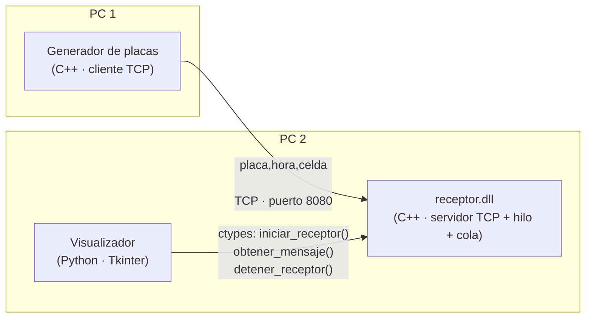

# Sistema de Parqueadero con Sockets y Librería Dinámica

Proyecto de Estructura de Datos. Simula un parqueadero de **30 celdas**: un generador envía placas por red y un visualizador muestra en tiempo real qué celdas están ocupadas o libres.

## Arquitectura



| Componente | Lenguaje | Carpeta | Función |
|---|---|---|---|
| Generador | C++ | `generador/` | Proceso **cliente**. Genera placas y las envía cada 2 a 5 segundos. |
| Receptor | C++ (DLL) | `receptor/` | Proceso **servidor**. Recibe las placas por socket en un hilo aparte y las guarda en una cola. |
| Visualizador | Python | `visualizacion/` | Carga la DLL con `ctypes`, lee los mensajes y muestra el parqueadero. |

El envío y la recepción de placas se hacen en C++, y el visualizador incorpora la librería dinámica para capturar la información del generador, tal como pide el enunciado.

## Protocolo

Cada mensaje es una línea de texto terminada en `\n`:

```
placa,hora,celda
ABC123,18:30:05,12
```

- **Placa:** 3 letras y 3 números.
- **Hora:** `HH:MM:SS`.
- **Celda:** número del 1 al 30.
- Si la placa **no está** en el parqueadero, es una **entrada** y ocupa la celda.
- Si la placa **ya está** en el parqueadero, es una **salida** y libera su celda.

## Estructura del repositorio

```
├── generador/        Generador de placas (cliente TCP)
│   └── config.txt    IP y puerto del receptor
├── receptor/         Receptor (DLL): receptor.cpp, receptor.slnx
├── visualizacion/    Visualizador en Python (main.py, interfaz.py, logica.py, receptor.py)
├── cliente_prueba/   Cliente manual para probar el receptor
├── pruebas/          prueba_dll.py: prueba de la DLL desde Python
└── docs/             Documentación de cada componente
```

## Requisitos

- Windows 10/11
- Visual Studio 2022 o superior con **Desarrollo para el escritorio con C++**
- Python 3.10 o superior de **64 bits** (por ejemplo, Anaconda). Tkinter viene incluido.

## Cómo compilar

### Receptor (DLL)
1. Abrir `receptor/receptor.slnx` en Visual Studio.
2. Seleccionar **Release** y **x64**.
3. Clic derecho en `receptor` → **Compilar**.
4. Resultado: `receptor/x64/Release/receptor.dll`.

La DLL debe ser de 64 bits, igual que Python. Se compila con `/MT`, así que no requiere instalar nada adicional en el PC donde se ejecute.

### Generador
1. Abrir el proyecto de `generador/` en Visual Studio.
2. Seleccionar **Release** y **x64** y compilar.
3. Dejar `config.txt` en la misma carpeta del `.exe`.

## Cómo ejecutar

**El receptor siempre se inicia antes que el generador.**

### En un solo PC
1. Copiar `receptor.dll` a la carpeta `visualizacion/`.
2. Abrir **Anaconda Prompt** y ejecutar:
   ```
   cd ruta\al\repositorio\visualizacion
   python main.py
   ```
3. En la ventana, pulsar **Iniciar** (debe decir `modo: DLL`).
4. Ejecutar el generador con `ip=127.0.0.1` en `config.txt`.

### En dos PCs
1. **PC 2 (visualizador):** obtener su IP con `ipconfig` (Dirección IPv4), ejecutar el visualizador y pulsar **Iniciar**. Si Windows pregunta por el firewall, permitir el acceso en redes privadas.
2. **PC 1 (generador):** en `config.txt` poner la IP del PC 2:
   ```
   ip=192.168.1.15
   puerto=8080
   ```
3. Ejecutar el generador.

Ambos PCs deben estar en la misma red.

### Probar solo el receptor
1. Copiar `receptor.dll` a `pruebas/` y ejecutar `python prueba_dll.py`.
2. Ejecutar `cliente_prueba` y escribir mensajes como `ABC123,18:30:05,12`.

## Problemas comunes

| Síntoma | Causa | Solución |
|---|---|---|
| Error **10061** en el generador o el cliente | El receptor no está corriendo o el puerto no coincide | Iniciar primero el visualizador o `prueba_dll.py`; revisar el puerto 8080 |
| Error **10060** | No llega al otro PC | Revisar la IP, que estén en la misma red y el firewall del PC 2 |
| `OSError` / `WinError 193` al cargar la DLL | La DLL y Python no tienen los mismos bits | Compilar la DLL en x64 y usar Python de 64 bits |
| `"python" no se reconoce` | Python de Anaconda no está en el PATH | Usar **Anaconda Prompt** |
| El visualizador dice `modo: MOCK` | Está usando mensajes de prueba | En `visualizacion/receptor.py` poner `USAR_MOCK = False` |

## Documentación

Más detalle de cada componente, el protocolo y los diagramas en la carpeta **[docs](docs/Home.md)**:

- [Arquitectura](docs/Arquitectura.md)
- [Protocolo](docs/Protocolo.md)
- [Receptor (DLL)](docs/Receptor-DLL.md)
- [Generador](docs/Generador.md)
- [Visualizador](docs/Visualizador.md)
- [Pruebas](docs/Pruebas.md)

El mismo contenido está en la **[Wiki](https://github.com/josuetamayo1/Entrega_2_Estructura/wiki)** del repositorio.

## Equipo

| Integrante | Componente |
|---|---|
| Cristopher Corrales | Receptor (DLL) |
| Johan López | Generador de placas |
| Josué Tamayo | Visualizador |
