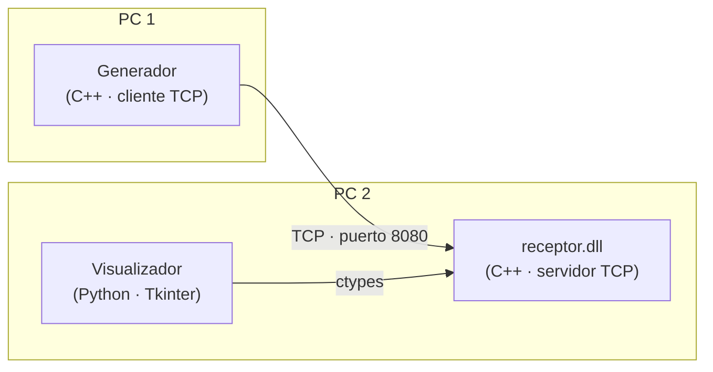
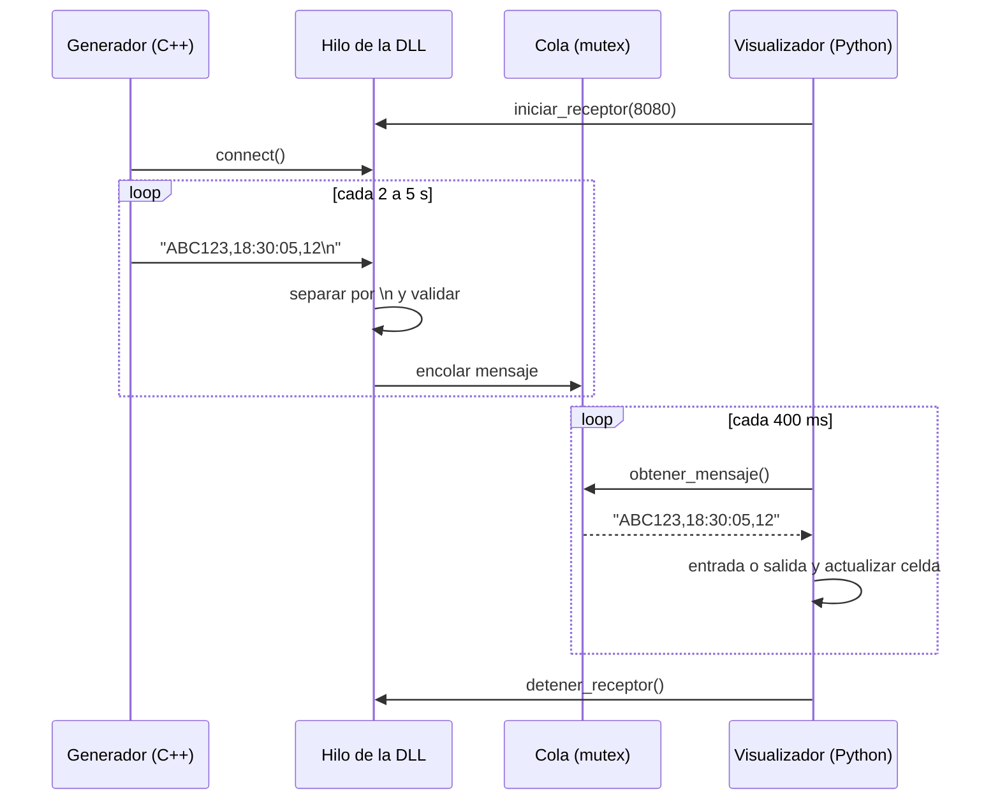

# Arquitectura

## Componentes

| Componente | Rol | Proceso | Comunicación |
|---|---|---|---|
| Generador | Cliente | `generador.exe` en el PC 1 | Envía mensajes por un socket TCP |
| Receptor | Servidor | Corre **dentro** del proceso de Python en el PC 2 | Escucha el socket y entrega los mensajes por funciones de la DLL |
| Visualizador | Interfaz | `python main.py` en el PC 2 | Llama a la DLL con `ctypes` |

## Por qué el receptor es una DLL

El enunciado pide que el envío y la recepción de placas se hagan en C++ y que el visualizador incorpore una librería dinámica para capturar la información del generador. Por eso el servidor de sockets vive dentro de `receptor.dll`:

1. El visualizador carga la DLL y llama a `iniciar_receptor(8080)`.
2. La DLL abre el socket y lanza un **hilo** que recibe los mensajes en segundo plano. La función regresa de inmediato, así la ventana de Python no se congela.
3. Cada mensaje válido se guarda en una **cola** protegida con un **mutex**.
4. El visualizador llama a `obtener_mensaje()` cada 400 ms y procesa lo que haya en la cola.

## Flujo de un mensaje

