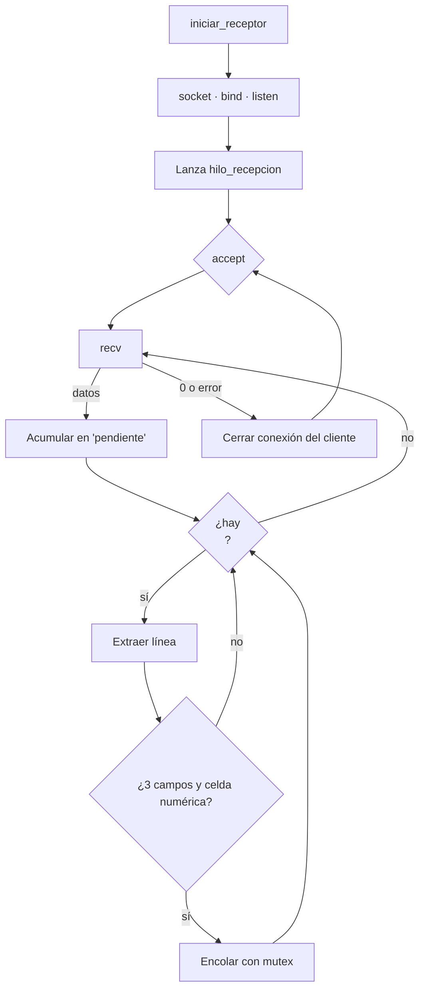

# Receptor (DLL)

**Responsable:** Cristopher Corrales · **Código:** `receptor/receptor.cpp`

Servidor TCP compilado como librería dinámica (`receptor.dll`). Recibe las placas del generador en un hilo aparte y se las entrega al visualizador mediante tres funciones exportadas.

## Funciones exportadas

```cpp
int  iniciar_receptor(int puerto);              // 1 = ok, 0 = error
int  obtener_mensaje(char* buffer, int tamano); // 1 = hay mensaje, 0 = cola vacía
void detener_receptor();
```

| Función | Qué hace |
|---|---|
| `iniciar_receptor` | Inicializa Winsock, crea el socket, hace `bind` y `listen` en el puerto y lanza el hilo de recepción. Regresa de inmediato. Devuelve 0 si el puerto está ocupado o si ya estaba iniciado. |
| `obtener_mensaje` | Saca el mensaje más antiguo de la cola y lo copia en el buffer de quien llama, con el formato `placa,hora,celda` y sin `\n`. Nunca escribe más de `tamano - 1` bytes. |
| `detener_receptor` | Cierra los sockets para desbloquear `accept` y `recv`, espera a que termine el hilo (`join`), vacía la cola y libera Winsock. |

Se exportan con `extern "C" __declspec(dllexport)`: `extern "C"` evita que C++ cambie los nombres de las funciones, así `ctypes` las encuentra por su nombre exacto.

## Funcionamiento interno



### Hilo de recepción
`accept` y `recv` son llamadas **bloqueantes**: se quedan esperando hasta que llegue algo. Si se ejecutaran en el hilo de Python, la ventana del visualizador se congelaría. Por eso corren en un `std::thread` aparte.

Si el generador se desconecta, el hilo vuelve al `accept` y espera otra conexión, sin que haya que reiniciar el visualizador.

### Acumulador de mensajes
Lo que llega en cada `recv` se agrega a un `std::string pendiente`. Mientras haya un `\n`, se extrae la línea completa con `substr` y se borra con `erase`. Lo que queda sin `\n` espera al siguiente `recv`. Así se manejan los mensajes pegados y los partidos.

### Validación
Cada línea se separa por comas con `std::stringstream` y `std::getline`. Si no tiene 3 partes, o si `std::stoi` no puede convertir la celda (se atrapa la excepción con `try/catch`), el mensaje se descarta sin detener el receptor.

### Cola y mutex
- `std::queue<std::string>`: el hilo de recepción **escribe** y el visualizador **lee**. Es una estructura **FIFO**: los mensajes salen en el mismo orden en que llegaron.
- `std::mutex` con `std::lock_guard`: evita que los dos hilos modifiquen la cola al mismo tiempo. El `lock_guard` bloquea al crearse y desbloquea solo al salir de la función.
- `std::atomic<bool> activo`: bandera compartida entre hilos que indica si el receptor debe seguir corriendo.

## Compilación

| Propiedad | Valor | Por qué |
|---|---|---|
| Tipo de configuración | Biblioteca dinámica (.dll) | Genera `receptor.dll` en vez de un `.exe` |
| Plataforma | x64 | Debe coincidir con Python de 64 bits |
| Biblioteca en tiempo de ejecución | Multiproceso (/MT) | Incluye el runtime de C++ dentro de la DLL, así funciona en otro PC sin instalar nada |

Resultado: `receptor/x64/Release/receptor.dll`. Solo depende de `KERNEL32.dll` y `WS2_32.dll`, que vienen con Windows.

## Uso desde Python

```python
import ctypes
lib = ctypes.CDLL("./receptor.dll")
lib.iniciar_receptor.argtypes = [ctypes.c_int]
lib.obtener_mensaje.argtypes = [ctypes.c_char_p, ctypes.c_int]

lib.iniciar_receptor(8080)
buf = ctypes.create_string_buffer(256)
if lib.obtener_mensaje(buf, len(buf)) == 1:
    print(buf.value.decode())   # "ABC123,18:30:05,12"
lib.detener_receptor()
```

Ver el script completo en `pruebas/prueba_dll.py`.

## Evolución

1. Servidor de consola que recibía un solo mensaje (ejemplo base).
2. Ciclo `while` para recibir varios mensajes.
3. Acumulador por `\n` y validación de placa, hora y celda.
4. Recepción en un hilo con cola protegida por mutex.
5. Conversión a DLL con las tres funciones del contrato.
