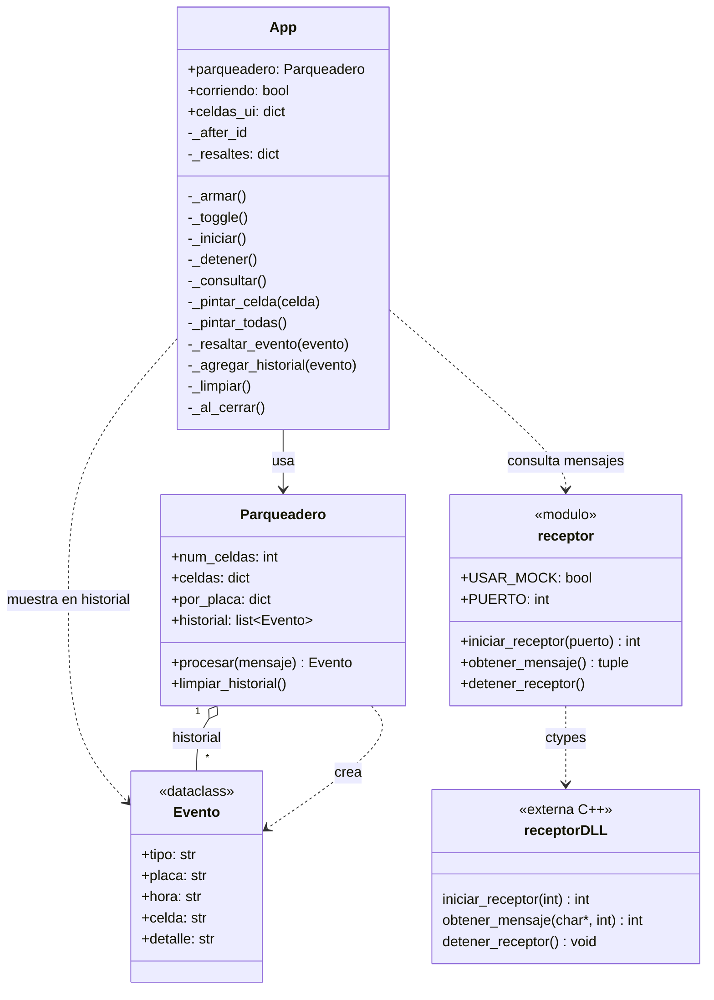

# Visualizador

**Responsable:** Josué Tamayo · **Código:** `visualizacion/`

Interfaz gráfica en Python con Tkinter que carga `receptor.dll` y muestra el estado del parqueadero en tiempo real.

## Archivos

| Archivo | Contenido |
|---|---|
| `main.py` | Punto de entrada. |
| `interfaz.py` | Ventana: cuadrícula de 5 × 6 celdas, contadores, botón Iniciar/Detener e historial. |
| `logica.py` | Clase `Parqueadero`: procesa cada mensaje como entrada, salida o error. |
| `receptor.py` | Puente con la DLL usando `ctypes`. Incluye un modo de prueba (`USAR_MOCK`) que genera mensajes falsos. |

## Funcionamiento

1. Al pulsar **Iniciar** se llama a `iniciar_receptor(8080)`.
2. Cada 400 ms, con `after()` de Tkinter, se piden hasta 10 mensajes con `obtener_mensaje()`. Así se consulta la DLL sin bloquear la ventana.
3. `Parqueadero.procesar()` decide:
   - Placa nueva y celda libre → **ENTRADA**: la celda se pinta de naranja con la placa.
   - Placa que ya está → **SALIDA**: su celda vuelve a verde (libre).
   - Formato inválido, hora inválida, celda fuera de rango o celda ocupada → **ERROR** en el historial.
4. Cada cambio se resalta brevemente en amarillo y se agrega al historial con su hora.
5. Al cerrar la ventana se llama a `detener_receptor()` para terminar el hilo de la DLL correctamente.

## Modo de prueba

En `receptor.py`:

| Variable | Desarrollo | Integración con la DLL |
|---|---|---|
| `USAR_MOCK` | `True` | `False` |
| `PUERTO` | — | `8080` |

`receptor.dll` debe estar en la carpeta `visualizacion/`.

## Diagrama UML

